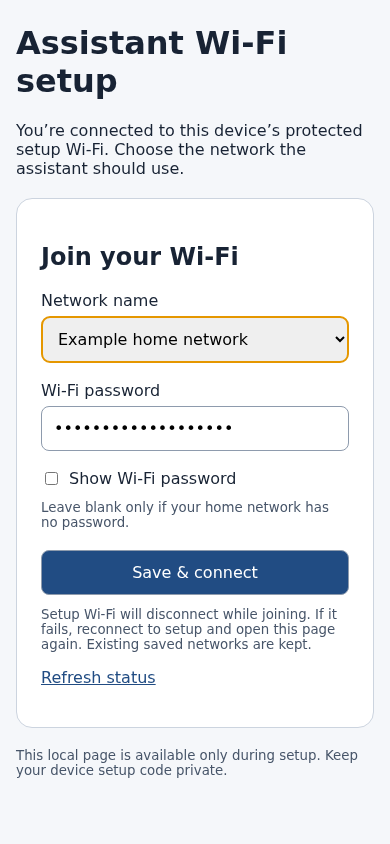

# Private Wi-Fi onboarding (H02)

## Install and save the device code

Run `make install-wifi` on the Pi after installing the repository's Python
requirements. A different environment can be selected with
`VENV=/path/to/venv bash scripts/install-wifi.sh`. Installation creates one random
code per device and preserves it on updates. It never prints the code automatically.
Retrieve it deliberately in a private terminal:

```sh
sudo piwifi-setup-code
sudo systemctl restart piwifi-manager.service
```

Save the displayed network name/code on a device label or in your private setup
notes before moving the assistant. The code is used once, as the setup Wi-Fi password;
the page has no second login. New installations use `PiAssistant-Setup-<device-id>`;
existing custom names are preserved. There is no shared default password. If your
phone saved the old setup password, forget that Wi-Fi entry and join with the new code.

The code lives in `/etc/piwifi/setup.json`, owned by root with mode 0600. Generate
it separately on each device; do not distribute that file in a cloned product image.
Lost labels can be recovered with the command above over SSH or a local console.
Do not put setup codes, home Wi-Fi passwords or this file in tickets or commits.

## Join from a phone

When no saved Wi-Fi connects, join the setup network using its device code. Keep
the phone connected even if it reports no Internet. Open `http://192.168.4.1`
(or your configured address/port). Choose the home network from the dropdown, or
choose **Enter another network…** to type its name. Enter its
password, then choose **Save & connect**. **Show Wi-Fi password** reveals/hides that
field so typing can be checked. The phone's own Wi-Fi screen controls revealing the
device code when joining setup.

The page acknowledges the attempt before Wi-Fi switches. The setup network then
disconnects. On success, reconnect the phone to home Wi-Fi; the setup page closes.
On failure, rejoin setup, refresh the page and retry. Previously working profiles
are preserved; a candidate profile becomes automatic only after activation succeeds.
The page supports open and WPA/WPA2 personal networks. Hidden-network discovery,
enterprise authentication and WPA3-only networks are outside this flow.
The baseline boards require a compatible 2.4 GHz network.

Joining WPA-protected setup Wi-Fi is the authentication step. The page binds to that
interface and address, rejects clients outside the setup subnet, and checks a signed
15-minute form session, token and request origin on changes. Expired forms or a
restarted service require refreshing the page. Submitted passwords are never returned
in responses. There is no separate browser login or user account.
HTTP is protected by the private hotspot's Wi-Fi encryption, not browser HTTPS;
anyone with the device code should be treated as authorized to change setup.

## Lifecycle and configuration

`/etc/default/piwifi` holds interface, setup name/address, port and timing settings;
it no longer contains `AP_PASSWORD`. Updates preserve the device code and configured
network settings. The old 30/15-second cycling defaults become 300/120 seconds;
the old default HTTP port 8080 becomes 80.
`AP_NO_CLIENT_TIMEOUT` and `AP_WIFI_RETRY_INTERVAL` accept zero to disable their
respective no-client expiry/retry. Actual associated phones prevent periodic AP
teardown. Saved Wi-Fi is retried when no phones are using setup. A bounded join marker
prevents the manager from interrupting an in-flight connection attempt.

Joining Wi-Fi closes both the AP and provisioning service even without Internet.
An Internet outage alone does not reopen setup or disrupt local assistant controls.
Stopping the manager also stops its setup service. The assistant's existing phone
controls on port 8767 are separate and keep their documented trusted-LAN access model.

## Secrets, failures and recovery

Wi-Fi passwords are passed in private NetworkManager keyfiles, never command-line
arguments. Successful profiles remain in NetworkManager for later connections.
Failed candidates are removed without replacing saved profiles. Interrupted attempts
can leave an inactive private candidate; they are not enabled for automatic connection.
Errors report failure without commands, submitted values, subprocess output or
tracebacks. Setup HTTP request logging is disabled because even a malformed URL can
contain a password. Existing system journals and backups are not retroactively erased.

Configuration installation saves previous provisioning files under a root-only
`/var/backups/piwifi/<timestamp>/` directory and restores them if writing fails.
This may include old shared setup credentials: keep backups private. For a software
rollback, stop `piwifi-manager`, restore that snapshot's files to their original
paths, run `systemctl daemon-reload`, then restart the manager. The H01 assistant
checkout and household state are unchanged. Older provisioning code restores its
old access protections and password-handling behavior.

## Browser check



Run `python tests/probe_piwifi_browser.py --chromium /path/to/chrome` on a development
computer, not the Pi. It reproduces the old `no-referrer`/`Origin: null` rejection,
then checks the actual page's native network dropdown, switching to/from manual entry,
Show password control and both form submission paths with `Referrer-Policy: same-origin`.
See the browser behavior documented
by [MDN](https://developer.mozilla.org/en-US/docs/Web/HTTP/Reference/Headers/Referrer-Policy#effect_on_the_origin_header).
This uses synthetic data and a fake join; actual network/phone checks are separate.

Validation and remaining hardware limits are recorded in TODO.md. The implementation
uses NetworkManager's documented [private keyfile format](https://networkmanager.dev/docs/api/latest/nm-settings-keyfile.html)
and Flask's [session and CSRF security guidance](https://flask.palletsprojects.com/en/stable/web-security/).
